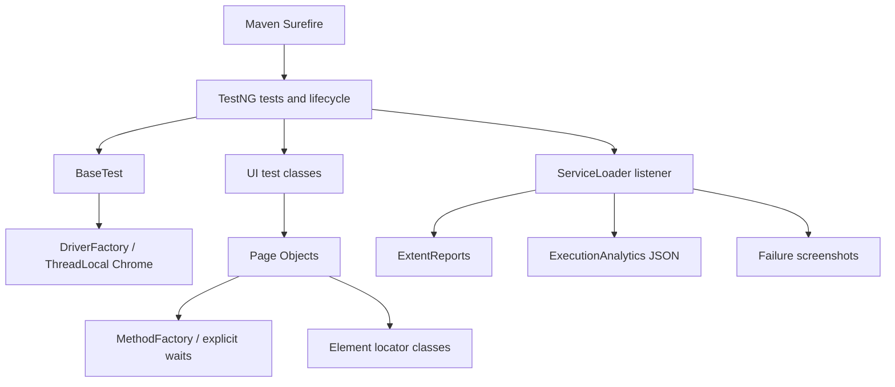

# Amazon SDET Automation Framework

## Project overview

Java UI automation for a small, explicitly scoped set of Amazon India homepage and search behaviors. The repository demonstrates browser lifecycle management, Page Objects, data-driven TestNG tests, failure diagnostics, reporting, and execution analytics. It does not automate account or purchase workflows.

## Technology stack

| Technology | Version |
| --- | --- |
| Java source/target | 21 |
| Selenium Java | 4.51.0 |
| TestNG | 7.11.0 |
| Maven Surefire | 3.5.5 |
| ExtentReports | 5.1.2 |
| Log4j API/Core and SLF4J binding | 2.26.1 |
| FreeMarker | 2.3.35 (declared dependency) |

## Architecture

- `DriverFactory` creates Chrome and stores it in a `ThreadLocal`; `BaseTest` creates and closes a fresh browser for each invocation.
- `MethodFactory` centralizes Selenium interactions and 15-second explicit waits.
- `BasePage` supplies the driver and interaction layer to page objects. `AmazonHomePage` and `AmazonSearchResultsPage` model the tested workflows.
- `elements` classes own the Amazon locators. Test classes own assertions and scenario flow.
- `ConfigReader` reads `config.properties`; JVM properties override file values.
- `ExtentReportListener` is registered with TestNG through `ServiceLoader`. `ExtentReportManager` owns one timestamped report per TestNG execution. `TestLogger` uses a `ThreadLocal` report node.
- `ExecutionAnalytics` records TestNG invocation outcomes, durations, screenshot capture results, and documented-scope coverage in a unique JSON file per execution.



## Project structure

```text
src/main/java/com/sksharma/automation/
  config/  driver/  elements/  factory/  pages/  utils/
src/main/resources/                 config.properties, log4j2.xml
src/test/java/com/sksharma/automation/
  dataproviders/  listeners/  reporting/  reports/  tests/
src/test/resources/
  META-INF/services/                TestNG listener registration
  in-scope-scenarios.txt             documented coverage denominator
.github/workflows/selenium-tests.yml
```

## Feasibility and test strategy

The local Chrome execution path reached Amazon India. The initial full suite
provided live search-result evidence, then a focused post-fix run validated
search and navigation. Amazon returned singular product words for plural
queries (for example, “Headphone” for “headphones” and “Keyboard” for
“keyboards”). This drove a general token-normalization fix. Filters, product
details, and cart were not traversed in this bounded inspection, so they remain
unverified and are not implemented.

| Candidate workflow | Assessment | Reason |
| --- | --- | --- |
| Product search and result integrity | Supported and suitable; implemented and live tested | Amazon returned result cards with product titles for the controlled queries. The test checks that at least one complete normalized query term occurs in the first title. This is lexical evidence, not a semantic relevance claim. |
| Partial product search | Unverified; not implemented | No live search results were available to establish predictable behavior. |
| Brand and price filters; price sorting | Unverified; not implemented | No DOM/control evidence, metadata, or numeric price parsing could be checked. |
| Product detail title and availability | Unverified; not implemented | No product page was reached; availability can vary by location and inventory. |
| Guest cart, quantity, removal, subtotal | Unverified; not implemented | No guest-session workflow or stable cart behavior could be inspected. No purchase flow is in scope. |
| Refresh and browser-back navigation | Supported and suitable; implemented and live tested | Both transitions completed in the focused Chrome run; search results remained available after refresh and the search input was available after browser back. |
| Login, checkout, purchase | Out of scope | The project excludes authentication and purchase completion. |

The code has six application test methods but only three workflow scenarios:
search, refresh, and browser-back. The other three checks confirm homepage
readiness or input state and are smoke checks, not business scenarios. The suite
deliberately stays at three unique customer workflow scenarios because the
remaining 10 candidates could not be verified. Scenario IDs below count methods,
not DataProvider rows. `in-scope-scenarios.txt` uses `IMPLEMENTED` and
`UNVERIFIED` rows to keep those sets separate. Confirmed coverage remains a
small part of Amazon India and does not include filters, product pages, or cart
behavior.

## Implemented scenarios

| Scenario ID | Test method | Validation objective | Status |
| --- | --- | --- | --- |
| NAV-01 | `BrowserLaunchTest.shouldOpenAmazonIndia` | Configured URL and non-empty page title after search readiness | Smoke check; live unverified |
| NAV-02 | `AmazonHomePageTest.shouldShowSearchInput` | Search input is displayed | Smoke check; live unverified |
| NAV-03 | `AmazonHomePageTest.shouldEnableSearchInput` | Search input is enabled | Smoke check; live unverified |
| DISC-01 | `AmazonSearchTest.shouldDisplaySearchResultsForSearchTerm` | Result URL retains the query, result cards exist, title is non-empty, and title identifies the query's normalized primary product term | Implemented and live tested; 4 data invocations |
| NAV-04 | `AmazonSearchTest.shouldRetainSearchStateAfterRefresh` | Search URL and results persist after refresh | Implemented and live tested |
| NAV-05 | `AmazonSearchTest.shouldReturnToHomepageWithBrowserBack` | Search input is available after browser back | Implemented and live tested |

The focused browser run recorded 6 TestNG invocations across 3 unique in-scope
methods: 4 search data rows, refresh, and browser back. All 6 passed, with 0
configuration failures. After tightening search integrity to require the
primary product term, a final search-only run recorded 4 invocations of DISC-01;
all 4 passed. Its JSON reports 1 unique in-scope scenario and 16.67% execution
coverage of the 6 implemented scope entries. The earlier full run discovered
10 invocations across 7 methods and exposed two assertion failures caused by
plural-versus-singular product wording. The framework setup check is not
application coverage. A separate framework-only run validates analytics output
without opening a browser and is not included in the browser metrics.

Search data is controlled in `AmazonSearchDataProvider`: laptop, headphones,
wireless mouse, and keyboards. These four values exercise one scenario method;
they are not counted as four unique business scenarios. `SearchTextNormalizer`
uses Unicode compatibility normalization, locale-stable lowercase, token
boundaries, and conservative English plural reduction (`-s`, `-es`, and `-ies`).
The controlled queries use their final term as the primary product category;
the result title must contain that complete normalized token. It does not
establish semantic relevance and can be affected by sponsored or changing
results.

## Setup and configuration

Prerequisites: Java 21, Maven 3.9+, Google Chrome, and network access to Amazon India. Selenium Manager resolves a compatible ChromeDriver; the environment must allow local driver ports.

```bash
git clone https://github.com/sksharma903231/amazon-sdet-automation.git
cd amazon-sdet-automation
mvn clean test-compile
```

Defaults in `src/main/resources/config.properties` are `browser=chrome`, `base.url=https://www.amazon.in/`, and `headless=false`. System properties override these values:

```bash
mvn test -Dbrowser=chrome -Dbase.url=https://www.amazon.in/ -Dheadless=false
```

## Execution commands

```bash
mvn clean test-compile
mvn test
mvn -Dtest=BrowserLaunchTest test
mvn -Dtest=AmazonSearchTest test
mvn test -Dbrowser=chrome -Dheadless=true
```

Surefire uses one fork and no automatic retries or parallel execution are configured. Each DataProvider row is a separate TestNG invocation and gets its own browser lifecycle.

## Reports and diagnostics

- Extent HTML: `reports/ExtentReport-<timestamp>.html`; collision suffixes prevent overwrites.
- Failure screenshots: `reports/screenshots/`, linked relative to the HTML report.
- JSON summaries: `reports/analytics/execution-<timestamp>-<execution-id>.json`.
- Log4j output: `logs/` and console.
- Surefire XML/text reports: `target/surefire-reports/`.

One listener handles Extent reporting, screenshots, and analytics. Screenshot capture failures are logged and do not replace the test failure. The report and JSON summary writers are best-effort diagnostics; their errors do not change TestNG test outcomes.

## Execution analytics

Metrics are calculated from TestNG result callbacks; no execution outcomes are prefilled. `totalInvocations` counts each DataProvider row. `uniqueScenarios` counts distinct test methods, not rows. Each invocation includes its scenario ID where scoped, method name, outcome, and duration. Setup/configuration failures are reported separately in `configurationFailures`; tests TestNG skips because setup failed remain skipped invocations.

- Pass rate = passed / (passed + failed) × 100. Skipped invocations are excluded; zero denominator yields 0.
- Suite duration = summary end timestamp minus execution start timestamp.
- Average test duration = sum of observed invocation durations / invocation count; an empty run yields 0.
- Screenshot success rate = successful screenshot files / eligible failed-invocation capture attempts × 100; zero attempts yields 0.
- `documentedScenarios` and automation coverage use only rows marked `IMPLEMENTED`; `unverifiedCandidates` counts candidates explicitly excluded from implementation. Execution scenario coverage counts unique in-scope methods observed in that run / implemented rows. DataProvider rows do not increase unique scenario counts. These are project-scope metrics, not Amazon application coverage.

Retries are not configured. Should retries be introduced later, the metric policy must be revisited so attempts are not misrepresented as independent successes.

## Repeatability procedure

Run five separate suite executions from the project root; each command creates a new JSON and Extent report:

```bash
for run in 1 2 3 4 5; do
  mvn --batch-mode test -Dbrowser=chrome -Dheadless=false
done
```

Review the five newest files under `reports/analytics/`. Compare `passRate`, failed and skipped counts, `totalDurationMs`, per-invocation durations and scenarios, and screenshot capture success rate. Look for repeated scenario failures. A sequence of runs is evidence for repeatability under those conditions, not additional application coverage. Keep the raw summaries with any reported stability claim.

## CI/CD

`.github/workflows/selenium-tests.yml` runs on pushes to and pull requests targeting `master`, configures Temurin Java 21 and Maven caching, provisions Chrome, and runs the suite headlessly. An always-run artifact step uploads Surefire output, Extent reports, screenshots, analytics, and logs. The workflow file is implemented; successful GitHub Actions operation still needs confirmation after pushing the branch and reviewing a real workflow run.

## Constraints and limitations

- Amazon may return CAPTCHA/bot checks, consent screens, regional redirects, or dynamic page structures; tests do not bypass those states.
- The tests need a reachable Amazon India endpoint and a functioning Chrome/ChromeDriver environment.
- Chrome is the only supported browser.
- The no-results state and its locator have not been verified, so no no-results assertion is included.
- Product order and content can change; tests do not assert exact products, prices, ratings, or inventory.
- No login, checkout, purchase, or other account side-effect workflow is covered.
- The selected scenarios validate a small UI surface, not the Amazon application as a whole.

## Future improvements

- Add browser support only when the environment and driver lifecycle can be validated across browsers.
- Add controlled local or mocked UI coverage for deterministic negative and error states.
- Validate the CI workflow with real GitHub runs and retain run evidence for repeatability analysis.
- Expand the documented in-scope scenario list alongside verified behavior and locators.
